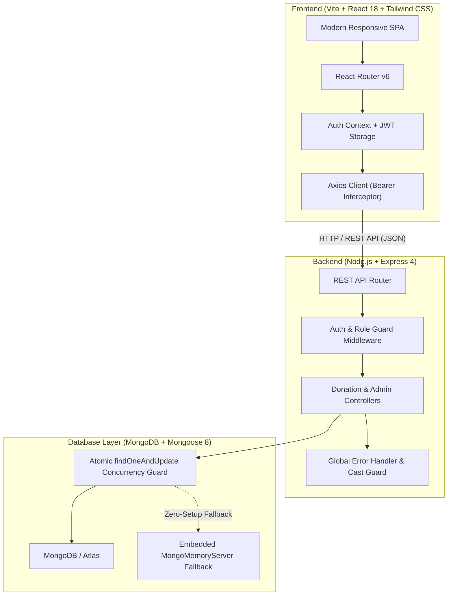

# SharePlate — Surplus Food Coordination Platform

SharePlate is a full-stack MERN web application built for an end-term software engineering project. It bridges commercial food donors (restaurants, university hostel mess halls, canteens, bakeries, event caterers) directly with verified non-governmental organizations (NGOs, community food banks, night shelters) to safely rescue edible surplus food before it goes to waste.

---

## 1. Table of Contents
- [Architecture & Tech Stack](#2-architecture--tech-stack)
- [User Roles & Permissions](#3-user-roles--permissions)
- [Core Workflows](#4-core-workflows)
- [Database Schema & Data Model](#5-database-schema--data-model)
- [REST API Reference](#6-rest-api-reference)
- [Quickstart & Local Installation](#7-quickstart--local-installation)
- [Pre-configured Demo Accounts](#8-pre-configured-demo-accounts)
- [Automated Testing & Concurrency Verification](#9-automated-testing--concurrency-verification)
- [Deployment Guide (Render & Vercel)](#10-deployment-guide-render--vercel)
- [Security & Business Logic Protections](#11-security--business-logic-protections)
- [Known Limitations](#12-known-limitations)

---

## 2. Architecture & Tech Stack



- **Frontend**: React 18, Vite 5, Tailwind CSS, Lucide React icons, React Router v6, Axios.
- **Backend**: Node.js (ESM modules), Express 4, Mongoose 8, JWT (`jsonwebtoken`), `bcryptjs`, `cors`, `helmet`.
- **Database**: MongoDB with atomic conditional updates (`findOneAndUpdate`) and compound status indexes. Includes zero-dependency fallback via `mongodb-memory-server` for effortless local execution.
- **Testing**: Vitest + Supertest for end-to-end integration tests, schema validation, and atomic concurrency testing.

---

## 3. User Roles & Permissions

| Role | Permissions & Capabilities |
|---|---|
| **Food Donor** | - Register & sign in as a food donor.<br/>- Create surplus food listings with quantity, safe deadline, allergens, dietary attributes, and pickup address.<br/>- View, edit, or cancel unreserved listings.<br/>- Track recipient claims and pickup handoffs in real-time. |
| **NGO / Recipient** | - Register & sign in with organization credentials.<br/>- Browse and filter live surplus food by category, dietary type, and safe collection deadline.<br/>- Claim available surplus food batches (requires administrator verification).<br/>- Coordinate pickups and advance status: `claimed` &rarr; `picked_up` &rarr; `completed`. |
| **Administrator** | - Access system governance console.<br/>- Review pending NGO verification applications and approve or reject them with feedback notes.<br/>- Moderate and suspend users or cancel inappropriate food listings.<br/>- Monitor aggregate platform metrics (meals rescued, active listings, verified shelters). |

---

## 4. Core Workflows

### Workflow A: Publish a Surplus Food Batch
1. Authenticated food donor accesses `/donor/create`.
2. Donor fills in the title, food category, quantity/unit, preparation time, safe collection deadline, pickup window, address, dietary attributes, and allergens.
3. The server validates:
   - Safe collection deadline must be in the future (`safeCollectionDeadline > Date.now()`).
   - Pickup window end must be after start, and cannot exceed the safe collection deadline.
   - Quantity must be a positive number greater than 0.
4. The donation is saved with status `available` and an initial audit entry in `statusHistory`.

### Workflow B: Discover & Claim Food (Atomic Race Prevention)
1. Recipient opens the live surplus food feed (`/feed`).
2. Search and filter by category, dietary preferences, or urgency. The server automatically excludes expired donations.
3. Recipient opens the donation details (`/donations/:id`).
4. Recipient clicks **Claim This Surplus Food**.
5. **Backend Atomic Concurrency Control**:
   ```javascript
   const donation = await Donation.findOneAndUpdate(
     { _id: donationId, status: 'available', safeCollectionDeadline: { $gt: new Date() } },
     {
       $set: { status: 'claimed', claimedBy: req.user._id, claimedAt: new Date() },
       $push: { statusHistory: { status: 'claimed', changedBy: req.user._id, changedAt: new Date(), note: 'Claimed' } }
     },
     { new: true }
   );
   ```
   If two organizations submit a claim simultaneously, MongoDB's atomic document locking ensures **exactly one succeeds** and the second receives a `409 Conflict` error.

### Workflow C: Pickup & Completion Tracking
1. The claimed donation displays donor contact and pickup address.
2. When the driver arrives and accepts the food, the recipient clicks **Mark Picked Up** (`picked_up`).
3. Upon community distribution, the recipient clicks **Mark Completed** (`completed`).
4. Timestamps (`pickedUpAt`, `completedAt`) and audit logs are recorded.

### Workflow D: Organization Verification
1. An NGO registers with organization name, type, charity registration / 501(c)(3) ID, and cold-storage facilities description.
2. The account is initialized with `verificationStatus: 'pending'`.
3. Unverified organizations can browse food listings, but claim attempts are rejected with `403 Forbidden` (`isVerificationRestricted: true`).
4. An administrator reviews the application in the Admin Console and marks it `approved` or `rejected` with notes.
5. If rejected, the NGO can view admin notes, update credentials, and resubmit for review.

---

## 5. Database Schema & Data Model

### User Schema (`users`)
```javascript
{
  name: { type: String, required: true },
  email: { type: String, required: true, unique: true, lowercase: true },
  password: { type: String, required: true, select: false },
  role: { type: String, enum: ['donor', 'recipient', 'admin'], default: 'donor' },
  phone: { type: String, required: true },
  address: { type: String },
  organization: {
    name: { type: String },
    type: { type: String, enum: ['restaurant', 'canteen', 'hostel', 'ngo', 'shelter', 'food_bank', 'caterer', 'other'] },
    regNumber: { type: String },
    description: { type: String },
    verificationStatus: { type: String, enum: ['pending', 'approved', 'rejected', 'not_applicable'] },
    verificationNotes: { type: String },
    verifiedAt: { type: Date },
    verifiedBy: { type: mongoose.Schema.Types.ObjectId, ref: 'User' }
  },
  status: { type: String, enum: ['active', 'suspended'], default: 'active' },
  timestamps: true
}
```

### Donation Schema (`donations`)
```javascript
{
  donor: { type: ObjectId, ref: 'User', required: true, index: true },
  title: { type: String, required: true },
  description: { type: String, required: true },
  category: { 
    type: String, 
    enum: ['Cooked Meals', 'Bakery & Bread', 'Fresh Produce', 'Dairy Products', 'Packaged Foods', 'Beverages', 'Other'],
    required: true,
    index: true 
  },
  quantity: { type: Number, required: true, min: 1 },
  unit: { type: String, enum: ['meals', 'kg', 'packets', 'servings', 'boxes', 'liters', 'portions'], required: true },
  preparationTime: { type: Date, required: true },
  safeCollectionDeadline: { type: Date, required: true, index: true },
  pickupWindow: {
    start: { type: Date, required: true },
    end: { type: Date, required: true }
  },
  pickupAddress: {
    street: { type: String, required: true },
    city: { type: String, required: true },
    landmark: { type: String },
    contactPhone: { type: String, required: true }
  },
  allergens: [String],
  dietaryType: { type: String, enum: ['Vegetarian', 'Vegan', 'Non-Vegetarian', 'Eggitarian'], default: 'Vegetarian' },
  storageCondition: { type: String, enum: ['Room Temperature', 'Refrigerated', 'Hot/Heated', 'Frozen'], default: 'Room Temperature' },
  imageUrl: { type: String },
  status: { 
    type: String, 
    enum: ['available', 'claimed', 'picked_up', 'completed', 'cancelled', 'expired'], 
    default: 'available', 
    index: true 
  },
  claimedBy: { type: ObjectId, ref: 'User', default: null, index: true },
  claimedAt: { type: Date },
  pickedUpAt: { type: Date },
  completedAt: { type: Date },
  cancelledAt: { type: Date },
  cancellationReason: { type: String },
  statusHistory: [
    {
      status: String,
      changedBy: { type: ObjectId, ref: 'User' },
      changedAt: { type: Date, default: Date.now },
      note: String
    }
  ],
  timestamps: true
}
```

---

## 6. REST API Reference

### Authentication (`/api/auth`)
| Method | Endpoint | Access | Description |
|---|---|---|---|
| `POST` | `/api/auth/register` | Public | Register user (Donor, NGO, Admin) |
| `POST` | `/api/auth/login` | Public | Authenticate user & receive JWT token |
| `GET` | `/api/auth/me` | Private | Get authenticated user profile & verification status |
| `PUT` | `/api/auth/profile` | Private | Update contact or re-submit organization verification |

### Donations (`/api/donations`)
| Method | Endpoint | Access | Description |
|---|---|---|---|
| `GET` | `/api/donations` | Public | Get live available unexpired food listings (search, filter, sort) |
| `GET` | `/api/donations/:id` | Public | Get full donation details and status audit trail |
| `GET` | `/api/donations/my-donations` | Private (Donor) | Get donations published by logged-in donor |
| `GET` | `/api/donations/my-claims` | Private (NGO) | Get donations claimed by logged-in recipient |
| `POST` | `/api/donations` | Private (Donor) | Create a surplus food donation listing |
| `PUT` | `/api/donations/:id` | Private (Donor) | Edit donation (permitted only if status is `available`) |
| `PATCH`| `/api/donations/:id/cancel` | Private (Donor/Admin) | Cancel donation with optional reason |
| `POST` | `/api/donations/:id/claim` | Private (Verified NGO) | Atomically claim donation with concurrency guard |
| `POST` | `/api/donations/:id/pickup` | Private (Claimant/Donor) | Mark donation status as `picked_up` |
| `POST` | `/api/donations/:id/complete` | Private (Claimant/Donor) | Mark donation status as `completed` |

### Administration (`/api/admin`)
| Method | Endpoint | Access | Description |
|---|---|---|---|
| `GET` | `/api/admin/metrics` | Private (Admin) | Platform statistics (meals rescued, active listings, users) |
| `GET` | `/api/admin/verifications` | Private (Admin) | List pending/approved/rejected organization applications |
| `PATCH`| `/api/admin/verifications/:userId`| Private (Admin)| Approve or reject NGO verification with review notes |
| `GET` | `/api/admin/users` | Private (Admin) | List all registered platform users with search & filters |
| `PATCH`| `/api/admin/users/:userId/status` | Private (Admin) | Toggle user status (`active` / `suspended`) |
| `GET` | `/api/admin/donations` | Private (Admin) | Comprehensive donation listings audit table |

---

## 7. Quickstart & Local Installation

### Prerequisites
- Node.js v18+ (tested on Node v20 & v24)
- npm v9+

### Step 1: Clone the Repository
```bash
git clone <repository_url>
cd MERN
```

### Step 2: Install Dependencies
```bash
# Installs backend, frontend, and root packages
npm run install:all
```

### Step 3: Configure Environment Variables
Copy the `.env.example` templates:
```bash
cp backend/.env.example backend/.env
cp frontend/.env.example frontend/.env
```

> **Note on MongoDB**: By default, `MONGODB_URI` is left blank in `backend/.env`. The application **automatically launches an embedded in-memory MongoDB server** (`mongodb-memory-server`) and seeds demo data on startup. No local MongoDB daemon or cloud setup is required!
> If you wish to use an external MongoDB or Atlas instance, simply supply your connection string in `backend/.env`:
> ```env
> MONGODB_URI=mongodb+srv://<username>:<password>@cluster0.mongodb.net/shareplate?retryWrites=true&w=majority
> ```

### Step 4: Run the Application
Launch both backend and frontend concurrently:
```bash
npm run dev
```

- **Frontend**: [http://localhost:5173](http://localhost:5173)
- **Backend API**: [http://localhost:5050](http://localhost:5050)
- **API Health Check**: [http://localhost:5050/api/health](http://localhost:5050/api/health)

---

## 8. Pre-configured Demo Accounts

When the database starts up empty, it is automatically seeded with realistic demo users across all roles. The login page (`/login`) also includes **1-click login buttons** for instant evaluation:

| Account Type | Email | Password | Role / Description |
|---|---|---|---|
| **System Admin** | `admin@shareplate.org` | `Admin@123` | Platform Administrator with verification & moderation privileges |
| **Food Donor** | `donor@greenleaf.com` | `Donor@123` | Green Leaf Organic Bistro (Chef Marcus Vance) |
| **College Canteen** | `canteen@university.edu` | `Donor@123` | University Central Canteen & Hostel Mess |
| **Verified NGO** | `ngo@cityrescue.org` | `Ngo@123` | City Food Rescue Foundation (Approved non-profit) |
| **Pending NGO** | `hope@shelter.org` | `Ngo@123` | Hope Community Night Shelter (Awaiting verification) |

---

## 9. Automated Testing & Concurrency Verification

A comprehensive Vitest + Supertest integration test suite is located in `backend/test/shareplate.test.js`.

### Run Integration Tests:
```bash
npm test
```

### What the Test Suite Verifies:
1. **User Registration & Authentication**: Hashes passwords with bcrypt, rejects duplicate emails, generates valid JWTs.
2. **Input Validation**: Enforces positive quantities, rejects past collection deadlines, and validates pickup windows.
3. **Automated Expiry Exclusion**: Ensures unexpired food appears in the feed while expired items are filtered out.
4. **Verification Enforcement**: Verifies that pending/unapproved NGOs are blocked from claiming food.
5. **Atomic Concurrency Protection**: Simultaneously launches competing claim requests for the exact same food listing from two different NGOs. Verifies that **exactly one claim succeeds (200 OK)** while the second receives **409 Conflict**, preventing double allocation.
6. **Status Lifecycle Transitions**: Validates `claimed` &rarr; `picked_up` &rarr; `completed` and ensures terminal states cannot be cancelled.
7. **Admin Governance**: Verifies NGO application approvals and metric reporting.

---

## 10. Deployment Guide (Render & Vercel)

### Backend Deployment (Render)
1. Push your repository to GitHub.
2. Log in to [Render](https://render.com) and click **New > Web Service**.
3. Select your repository.
4. Configure settings:
   - **Root Directory**: `backend`
   - **Environment**: `Node`
   - **Build Command**: `npm install`
   - **Start Command**: `npm start`
5. Under **Environment Variables**, add:
   - `NODE_ENV`: `production`
   - `PORT`: `10000`
   - `MONGODB_URI`: `<Your MongoDB Atlas connection URI>`
   - `JWT_SECRET`: `<A strong random secret string>`
   - `CLIENT_URL`: `https://<your-frontend-domain>.vercel.app`
6. Deploy the web service. Note the backend API URL (e.g. `https://shareplate-api.onrender.com`).

### Frontend Deployment (Vercel)
1. Log in to [Vercel](https://vercel.com) and click **Add New > Project**.
2. Select your repository.
3. Configure settings:
   - **Root Directory**: `frontend`
   - **Framework Preset**: `Vite`
   - **Build Command**: `npm run build`
   - **Output Directory**: `dist`
4. Under **Environment Variables**, add:
   - `VITE_API_BASE_URL`: `https://shareplate-api.onrender.com/api`
5. Deploy. The included `frontend/vercel.json` ensures client-side routing routes all paths to `index.html` cleanly.

---

## 11. Security & Business Logic Protections

- **Password Hashing**: Passwords are encrypted using salted bcrypt (`bcryptjs`, 10 rounds).
- **JWT Protection**: Tokens are signed with secret keys stored in environment variables, with role verification on every protected endpoint.
- **Server-side Role Authorization**: Access is strictly guarded at the Express middleware level (`requireRole`, `requireVerifiedRecipient`), preventing API spoofing even if client-side UI is modified.
- **Atomic Concurrency**: Mongoose `findOneAndUpdate` ensures race-condition immunity when claiming donations.
- **Mass Assignment Prevention**: Strict controllers whitelist updatable fields, preventing privilege escalation.
- **HTTP Security Headers**: Powered by `helmet` to mitigate clickjacking, XSS, and MIME sniffing.

---

## 12. Known Limitations

- **Image Storage**: The current implementation accepts image URLs and provides realistic preset photography. For large-scale multi-gigabyte direct file uploads, integration with Amazon S3 or Cloudinary is recommended.
- **Push Notifications**: Real-time status notifications currently update on polling / page refresh. Integration with WebSockets (Socket.io) or Web Push API would enable instant mobile push notifications when a donation is claimed.
- **Automated Geocoding**: Address coordinates are stored as text fields; integrating the Google Maps / OpenStreetMap Nominatim API would enable exact radius-based kilometer proximity filtering.
